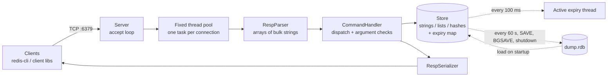

# redis-from-scratch

[](https://github.com/dhootatharva/redis-from-scratch/actions/workflows/tests.yml)

[](LICENSE)

A Redis-compatible in-memory key-value server written from scratch in Java 17, with no external dependencies. It speaks the Redis wire protocol (RESP), so `redis-cli` and standard Redis client libraries can talk to it. It supports 42 commands across strings, lists and hashes, key expiry, concurrent clients, and snapshot persistence with crash-safe writes.

```text
$ redis-cli -p 6379
127.0.0.1:6379> SET session:42 alice EX 60
OK
127.0.0.1:6379> TTL session:42
(integer) 60
127.0.0.1:6379> LPUSH jobs a b c
(integer) 3
127.0.0.1:6379> LRANGE jobs 0 -1
1) "c"
2) "b"
3) "a"
127.0.0.1:6379> GET jobs
(error) WRONGTYPE Operation against a key holding the wrong kind of value
```

## Architecture



| Component | File | What it does |
|---|---|---|
| Network server | `Server.java` | Listens on port 6379 (or the port given as the first argument) and hands each connection to a fixed pool of 100 worker threads. Saves a snapshot from a shutdown hook on Ctrl+C. |
| Protocol | `RespParser.java`, `RespSerializer.java` | Parses RESP arrays of bulk strings and inline commands from a buffered socket stream (pipelined commands work), checking every length and count against a limit before acting on it. Keys and values are binary-safe. Encodes simple strings, errors, integers, bulk strings, nulls and arrays. |
| Commands | `CommandHandler.java` | Validates arity and options, maps each command to a store operation, and turns failures into RESP errors. |
| Keyspace | `Store.java` | One map from key to a typed entry (string, list or hash) that holds the value and its absolute expiry deadline together. Guarded by a single lock. Enforces `WRONGTYPE` across types. |
| Persistence | `Persistence.java` | Binary snapshot (`dump.rdb`) with a magic header, one type byte per entry, and expiry timestamps. Written to a temp file and then renamed, so a crash mid-write never corrupts the last good snapshot. |

## Supported commands (42)

| Group | Commands |
|---|---|
| Connection | `PING`, `ECHO` |
| Strings | `SET` (with `EX`, `PX`, `NX`, `XX`), `GET`, `GETDEL`, `SETNX`, `MSET`, `MGET`, `APPEND`, `STRLEN`, `INCR`, `DECR`, `INCRBY`, `DECRBY` |
| Keys | `DEL`, `EXISTS`, `KEYS`, `TYPE`, `RENAME`, `DBSIZE`, `FLUSHALL` |
| Expiry | `EXPIRE`, `TTL`, `PTTL`, `PERSIST` |
| Lists | `LPUSH`, `RPUSH`, `LPOP`, `RPOP`, `LLEN`, `LRANGE`, `LINDEX` |
| Hashes | `HSET`, `HGET`, `HGETALL`, `HDEL`, `HEXISTS`, `HLEN`, `HKEYS`, `HVALS` |
| Persistence | `SAVE`, `BGSAVE` |

## Design notes

**Expiry uses two mechanisms, like Redis.**
- *Lazy:* every read or write checks the key's deadline first and deletes it if it has passed, so an expired key is never returned.
- *Active:* a background thread sweeps the expiry map every 100 ms, so keys that are never read again still free their memory.

`TTL` and `PTTL` return `-1` for keys with no expiry and `-2` for missing keys, matching Redis.

**Type safety.** Each key maps to exactly one entry, and an entry has exactly one type, so a key can never hold two types at once. A command that needs a different type gets Redis's `WRONGTYPE` error.

**Binary safety.** Redis keys and values are bytes, not text. Decoding them as UTF-8 would corrupt anything that is not valid UTF-8, so the server decodes with ISO-8859-1, which maps each byte to exactly one char and back. Internally a string holds one char per byte, its length is its byte length, and what a client stores is returned byte for byte. `Binary.java` is the only place that converts.

**Untrusted input.** A length or count from a client is a claim, so the parser checks it before using it, with the same limits as Redis: 512 MB per value, 1,048,576 arguments per command, 64 KB per header line. Input that is not valid RESP gets `-ERR Protocol error: ...` and the connection is closed, because the server can no longer tell where the next command starts. The reply is sent before a lingering close, so it reaches the client even when unread input is still pending. An empty command is ignored, and a bug inside a command becomes an error reply, not a dropped connection.

**Persistence and recovery.**
- *When it saves:* every 60 seconds in a background thread, on `SAVE`, on `BGSAVE` (non-blocking, on a separate thread), and on shutdown.
- *What it writes:* the keyspace is copied in memory while holding the store lock, and the copy is written after releasing it. A snapshot therefore shows the data at one instant, and clients are not blocked during the disk write.
- *How it writes:* the snapshot goes to `dump.rdb.tmp` first and is renamed only after a complete write.
- *On startup:* the server reloads the snapshot and skips keys whose deadline has already passed. Expiry is stored as absolute time, so TTLs keep counting down across restarts.
- *Format:* the snapshot is this project's own compact binary format. It is not byte-compatible with real Redis RDB files. Snapshots written before values became binary-safe (header `REDIS0001`) are still readable and are converted while loading.

**Concurrency.** Each client runs on its own pool thread, which does the network reads, parsing and replies in parallel with other clients. Command execution is serialised by one lock on the store, so every command is atomic: `INCR` never loses an update, and `SET ... NX` has exactly one winner. Real Redis gets the same guarantee by executing all commands on a single thread. The active expiry sweep takes the same lock, so it never runs in the middle of a command.

## Run it

Requires Java 17+.

```bash
./gradlew build                          # compiles and runs the tests (Windows: gradlew.bat build)
java -jar app/build/libs/app.jar         # starts on port 6379
java -jar app/build/libs/app.jar 6380    # or pick a port, e.g. if a real Redis already uses 6379
redis-cli -p 6379 PING                   # -> PONG
```

## Tests

`./gradlew test` runs JUnit tests for the protocol layer (parsing pipelined and inline commands, binary safety for every byte value, rejection of malformed and oversized input, reply encoding) and for command behaviour against Redis semantics:
- `SET` with `NX`/`XX`, and the counter commands
- `LPUSH` ordering and hash commands
- `WRONGTYPE` errors, `STRLEN` in bytes
- `TTL`/`PERSIST` return codes, and keys disappearing once they expire

The suite also includes end-to-end tests that start the server on a free port and talk to it over real TCP sockets (pipelining, a command split across two writes, many clients at once), persistence tests (save, restart, reload, TTLs across downtime), and expiry tests driven by an injected clock, so nothing sleeps.

`./gradlew knownBugs` runs a separate set of tests tagged `known-bug`. They describe correct Redis behaviour that this server does not have yet (argument validation, `KEYS` patterns, values too large for a snapshot, and others) and are expected to fail. They stay out of the normal build so it remains green; each fix moves its test into the main suite.

With Docker (build the jar first):

```bash
./gradlew build
docker build -t redis-from-scratch .
docker run -p 6379:6379 redis-from-scratch
```

## Project structure

```
app/src/main/java/redis/
  Server.java          TCP accept loop, thread pool, shutdown hook
  RespParser.java      RESP request parsing and validation
  ProtocolException.java  input that is not valid RESP
  Binary.java          bytes <-> internal strings, one char per byte
  RespSerializer.java  RESP response encoding
  CommandHandler.java  command dispatch and validation
  Store.java           keyspace, types, lazy + active expiry, background save
  Persistence.java     binary snapshot save/load
app/src/test/java/redis/
  RespTest.java               protocol parsing and encoding
  CommandHandlerTest.java     command semantics
  ConcurrencyTest.java        atomic commands under many threads
  ExpiryTest.java             lazy and active expiry with a controlled clock
  PersistenceTest.java        snapshot save, restart and reload
  SnapshotFormatTest.java     snapshot versions and binary data
  ProtocolTest.java           binary safety and malformed input over sockets
  ServerIntegrationTest.java  real server, real sockets
  KnownBugs*Test.java         failing tests for known bugs (./gradlew knownBugs)
Dockerfile
```

## Known limitations

- **Commands execute one at a time.** Network I/O is parallel, but command execution holds a single lock, so it does not scale across CPU cores. Redis makes the same trade-off. `SAVE` and `BGSAVE` both copy the keyspace under the lock, which pauses other commands briefly and needs memory for the copy; Redis avoids this with `fork()` and copy-on-write.
- One thread per connection caps concurrent clients at the pool size (100). An NIO event loop would scale further.
- No pipelining-specific optimisations, pub/sub, transactions (`MULTI`/`EXEC`), sets, sorted sets or replication.
- The active expiry sweep scans every key with a TTL. Redis samples 20 keys at a time to bound the cost.
- Snapshots store strings with Java's `writeUTF`, which cannot write more than 65,535 encoded bytes per string, and encodes bytes above 127 as two. A key or value over 64 KB of text, or about 32 KB of arbitrary binary data, makes the whole save fail.
- Snapshot persistence only: writes made after the last snapshot are lost if the process is killed. Redis offers an append-only file for this.

## License

MIT
