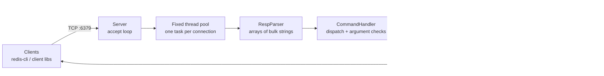

# redis-from-scratch

A Redis-compatible in-memory key-value server written from scratch in Java 17, with no external dependencies. It speaks the Redis wire protocol (RESP), so `redis-cli` and standard Redis client libraries can talk to it. It supports 42 commands across strings, lists and hashes, key expiry, concurrent clients, and snapshot persistence with crash-safe writes.

```text
$ redis-cli -p 6379
127.0.0.1:6379> SET session:42 alice EX 60
OK
127.0.0.1:6379> TTL session:42
(integer) 60
127.0.0.1:6379> LPUSH jobs a b c
(integer) 3
127.0.0.1:6379> LRANGE jobs 0 -1
1) "c"
2) "b"
3) "a"
127.0.0.1:6379> GET jobs
(error) WRONGTYPE Operation against a key holding the wrong kind of value
```

## Architecture



| Component | File | What it does |
|---|---|---|
| Network server | `Server.java` | Listens on port 6379 (or the port given as the first argument) and hands each connection to a fixed pool of 100 worker threads. Saves a snapshot from a shutdown hook on Ctrl+C. |
| Protocol | `RespParser.java`, `RespSerializer.java` | Parses RESP arrays of bulk strings from a buffered socket stream (pipelined commands work); encodes simple strings, errors, integers, bulk strings, nulls and arrays. |
| Commands | `CommandHandler.java` | Validates arity and options, maps each command to a store operation, and turns failures into RESP errors. |
| Keyspace | `Store.java` | Three `ConcurrentHashMap`s (strings, lists, hashes) plus an expiry map of absolute timestamps. Enforces `WRONGTYPE` across types. |
| Persistence | `Persistence.java` | Binary snapshot (`dump.rdb`) with a magic header, one type byte per entry, and expiry timestamps. Written to a temp file and then renamed, so a crash mid-write never corrupts the last good snapshot. |

## Supported commands (42)

| Group | Commands |
|---|---|
| Connection | `PING`, `ECHO` |
| Strings | `SET` (with `EX`, `PX`, `NX`, `XX`), `GET`, `GETDEL`, `SETNX`, `MSET`, `MGET`, `APPEND`, `STRLEN`, `INCR`, `DECR`, `INCRBY`, `DECRBY` |
| Keys | `DEL`, `EXISTS`, `KEYS`, `TYPE`, `RENAME`, `DBSIZE`, `FLUSHALL` |
| Expiry | `EXPIRE`, `TTL`, `PTTL`, `PERSIST` |
| Lists | `LPUSH`, `RPUSH`, `LPOP`, `RPOP`, `LLEN`, `LRANGE`, `LINDEX` |
| Hashes | `HSET`, `HGET`, `HGETALL`, `HDEL`, `HEXISTS`, `HLEN`, `HKEYS`, `HVALS` |
| Persistence | `SAVE`, `BGSAVE` |

## Design notes

**Expiry uses two mechanisms, like Redis.**
- *Lazy:* every read or write checks the key's deadline first and deletes it if it has passed, so an expired key is never returned.
- *Active:* a background thread sweeps the expiry map every 100 ms, so keys that are never read again still free their memory.

`TTL` and `PTTL` return `-1` for keys with no expiry and `-2` for missing keys, matching Redis.

**Type safety.** Strings, lists and hashes live in separate maps. Every command checks that the key is not held by another type and returns Redis's `WRONGTYPE` error if it is.

**Persistence and recovery.**
- *When it saves:* every 60 seconds in a background thread, on `SAVE`, on `BGSAVE` (non-blocking, on a separate thread), and on shutdown.
- *How it writes:* the snapshot goes to `dump.rdb.tmp` first and is renamed only after a complete write.
- *On startup:* the server reloads the snapshot and skips keys whose deadline has already passed. Expiry is stored as absolute time, so TTLs keep counting down across restarts.
- *Format:* the snapshot is this project's own compact binary format. It is not byte-compatible with real Redis RDB files.

**Concurrency.** Each client runs on its own pool thread. The keyspace uses `ConcurrentHashMap` and `CopyOnWriteArrayList`, so single-key reads and writes are thread-safe without a global lock.

## Run it

Requires Java 17+.

```bash
./gradlew build                          # compiles and runs the tests (Windows: gradlew.bat build)
java -jar app/build/libs/app.jar         # starts on port 6379
java -jar app/build/libs/app.jar 6380    # or pick a port, e.g. if a real Redis already uses 6379
redis-cli -p 6379 PING                   # -> PONG
```

## Tests

`./gradlew test` runs JUnit tests for the protocol layer (parsing pipelined commands, byte-accurate bulk-string lengths for UTF-8 values, reply encoding) and for command behaviour against Redis semantics:
- `SET` with `NX`/`XX`, and the counter commands
- `LPUSH` ordering and hash commands
- `WRONGTYPE` errors, `STRLEN` in bytes
- `TTL`/`PERSIST` return codes, and keys disappearing once they expire

With Docker (build the jar first):

```bash
./gradlew build
docker build -t redis-from-scratch .
docker run -p 6379:6379 redis-from-scratch
```

## Project structure

```
app/src/main/java/redis/
  Server.java          TCP accept loop, thread pool, shutdown hook
  RespParser.java      RESP request parsing
  RespSerializer.java  RESP response encoding
  CommandHandler.java  command dispatch and validation
  Store.java           keyspace, types, lazy + active expiry, background save
  Persistence.java     binary snapshot save/load
app/src/test/java/redis/
  RespTest.java            protocol parsing and encoding
  CommandHandlerTest.java  command semantics
Dockerfile
```

## Known limitations

- **Read-modify-write commands are not atomic under concurrency.** `INCR`, `APPEND` and similar commands read a value and then write it back. Two clients updating the same key at the same moment can lose an update. Real Redis avoids this by executing commands on a single thread. A per-key lock or a single command-executor thread would fix it.
- One thread per connection caps concurrent clients at the pool size (100). An NIO event loop would scale further.
- No pipelining-specific optimisations, pub/sub, transactions (`MULTI`/`EXEC`), sets, sorted sets or replication.
- The active expiry sweep scans every key with a TTL. Redis samples 20 keys at a time to bound the cost.
- Snapshots store strings with Java's `writeUTF`, which limits a single key or value to 64 KB when saved.
- Snapshot persistence only: writes made after the last snapshot are lost if the process is killed. Redis offers an append-only file for this.

## License

MIT
