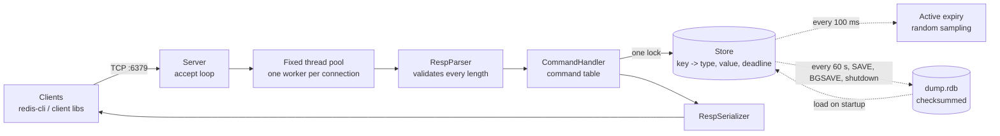

# redis-from-scratch

[](https://github.com/dhootatharva/redis-from-scratch/actions/workflows/tests.yml)

[](LICENSE)

A Redis-compatible in-memory key-value server written from scratch in Java 17. The server itself has no dependencies. It speaks the Redis wire protocol (RESP), so `redis-cli` and standard Redis client libraries can talk to it; the test suite proves this by driving it with [Jedis](https://github.com/redis/jedis). It supports 47 commands across strings, lists and hashes, with atomic commands, key expiry, binary-safe values, and checksummed snapshot persistence.

```text
$ redis-cli -p 6379
127.0.0.1:6379> SET session:42 alice EX 60
OK
127.0.0.1:6379> TTL session:42
(integer) 60
127.0.0.1:6379> LPUSH jobs a b c
(integer) 3
127.0.0.1:6379> LRANGE jobs 0 -1
1) "c"
2) "b"
3) "a"
127.0.0.1:6379> GET jobs
(error) WRONGTYPE Operation against a key holding the wrong kind of value
```

## Architecture



| Component | File | What it does |
|---|---|---|
| Network server | `Server.java` | Listens on port 6379 (or the port given as the first argument) and gives each connection to one of 100 worker threads. A client over the limit is told so and disconnected. Shuts down cleanly on Ctrl+C. |
| Protocol | `RespParser.java`, `RespSerializer.java` | Parses RESP arrays and inline commands from a buffered stream (pipelined commands work), checking every length and count against a limit before acting on it. Encodes all reply types. |
| Commands | `CommandHandler.java` | A table of commands: name, argument count and action. One dispatch method looks the command up, checks its arguments, takes the lock and converts errors. |
| Keyspace | `Store.java` | One map from key to an entry holding its type, value and expiry deadline together. Guarded by a single lock, so every command is atomic. |
| Persistence | `Persistence.java` | Binary snapshot (`dump.rdb`) with a version header and a CRC-32 checksum, written to a temp file, flushed to disk and renamed. |

## Supported commands (47)

| Group | Commands |
|---|---|
| Connection | `PING`, `ECHO`, `SELECT`, `CLIENT`, `COMMAND` |
| Strings | `SET` (with `EX`, `PX`, `NX`, `XX`), `GET`, `GETDEL`, `SETNX`, `MSET`, `MGET`, `APPEND`, `STRLEN`, `INCR`, `DECR`, `INCRBY`, `DECRBY` |
| Keys | `DEL`, `EXISTS`, `KEYS` (glob patterns), `TYPE`, `RENAME`, `DBSIZE`, `FLUSHALL` |
| Expiry | `EXPIRE`, `TTL`, `PTTL`, `PERSIST` |
| Lists | `LPUSH`, `RPUSH`, `LPOP`, `RPOP`, `LLEN`, `LRANGE`, `LINDEX` |
| Hashes | `HSET`, `HGET`, `HGETALL`, `HDEL`, `HEXISTS`, `HLEN`, `HKEYS`, `HVALS` |
| Server | `SAVE`, `BGSAVE`, `INFO`, `CONFIG GET` |

`SELECT`, `CLIENT`, `COMMAND`, `CONFIG GET` and `INFO` are minimal: they answer what client libraries and tools ask while connecting.

## Design notes

**Atomic commands.** Each client has its own worker thread, which reads from the socket, parses and writes replies in parallel with other clients. Executing a command is different: it happens while holding one lock on the store, so only one command touches the data at a time. `INCR` never loses an update, and `SET ... NX` has exactly one winner, which is what makes it usable as a lock. Real Redis gets the same guarantee by executing all commands on a single thread. The slow part of serving a client is the network, not the in-memory operation, so serialising only the operation costs little.

**One entry per key.** A key maps to a single entry that holds its type, its value and its deadline. A key therefore cannot hold two types, and its value and deadline cannot disagree. Lazy expiry is implemented once, in the lookup every command goes through.

**Expiry uses two mechanisms, like Redis.**
- *Lazy:* every lookup checks the key's deadline first and deletes the key if it has passed, so an expired key is never returned.
- *Active:* ten times a second, a background sweep picks 20 random keys that have a deadline and deletes the expired ones. If more than a quarter of the sample was expired, it samples again, for at most a few milliseconds. The cost of a sweep does not depend on how many keys exist.

Deadlines are absolute timestamps, so a TTL keeps counting down while the server is stopped. `TTL` and `PTTL` return `-1` for keys with no expiry and `-2` for missing keys, matching Redis.

**Binary safety.** Redis keys and values are bytes, not text. Decoding them as UTF-8 would corrupt anything that is not valid UTF-8, so the server decodes with ISO-8859-1, which maps each byte to exactly one char and back. Internally a string holds one char per byte, its length is its byte length, and what a client stores is returned byte for byte. `Binary.java` is the only place that converts.

**Untrusted input.** A length or count from a client is a claim, so the parser checks it before using it, with the same limits as Redis: 512 MB per value, 1,048,576 arguments per command, 64 KB per header line. Input that is not valid RESP gets `-ERR Protocol error: ...` and the connection is closed, because the server can no longer tell where the next command starts. An empty command is ignored, and a bug inside a command becomes an error reply, not a dropped connection.

**Persistence and recovery.** A snapshot is taken every 60 seconds, on `SAVE`, on `BGSAVE` and on shutdown. A save gives four guarantees:
- *Consistent:* the keyspace is copied in memory while holding the lock and written from the copy, so the file shows the data at one instant.
- *Atomic:* the snapshot goes to `dump.rdb.tmp` and is renamed over the old file only when complete.
- *Durable:* the temp file is flushed to the disk itself (`fsync`) before the rename.
- *Verifiable:* a CRC-32 of the file is stored at its end and checked on load.

Loading is all or nothing. If the file is truncated, fails its checksum or is not a snapshot, the server refuses to start. Starting empty would be worse: the next automatic save would overwrite the damaged file. `SAVE` reports failure instead of always answering `OK`, and a failed save leaves the previous snapshot untouched. The format is this project's own and is not byte-compatible with Redis RDB files; snapshots from earlier versions of this server still load.

**Data structures.** Lists are double-ended queues, so pushing and popping at either end takes constant time. The keys with a deadline are indexed in a structure that supports constant-time add, remove and random pick, which is what sampling needs.

Measured in-process on one machine, before and after these two choices:

| Operation | Before | After |
|---|---|---|
| 100,000 × `LPUSH` onto one list | 575 ms | 78 ms |
| 100,000 × `LPOP` from that list | 389 ms | 11 ms |
| One active-expiry sweep, 200,000 keys with a TTL | 14.2 ms | 0.012 ms |

## Run it

Requires Java 17+.

```bash
./gradlew build                          # compiles and runs the tests (Windows: gradlew.bat build)
java -jar app/build/libs/app.jar         # starts on port 6379
java -jar app/build/libs/app.jar 6380    # or pick a port, e.g. if a real Redis already uses 6379
java -jar app/build/libs/app.jar --verbose   # also log every connection and command
redis-cli -p 6379 PING                   # -> PONG
```

No `redis-cli`? Inline commands work, so `telnet localhost 6379` or `nc localhost 6379` and typing `PING` is enough.

With Docker (build the jar first):

```bash
./gradlew build
docker build -t redis-from-scratch .
docker run -p 6379:6379 -v redis-data:/data redis-from-scratch
```

The container runs as a non-root user and keeps `dump.rdb` in the `/data` volume.

## Tests

`./gradlew test` runs 147 JUnit tests. None of them sleeps to wait for time to pass: expiry is driven by an injected clock.

| Test class | What it covers |
|---|---|
| `RespTest` | Parser and serializer rules: framing, every byte value, each kind of malformed input |
| `ProtocolTest` | The same over real sockets: binary safety, inline commands, protocol errors and the close that follows |
| `CommandHandlerTest` | Command behaviour against Redis semantics |
| `CommandValidationTest` | Argument counts, number parsing, option syntax, overflow, exact error text |
| `GlobTest` | The `KEYS` pattern matcher |
| `ConcurrencyTest` | Many threads at once: no lost increments, one `SET NX` winner, no key with two types, saving while writing |
| `ExpiryTest`, `DataStructureTest` | Lazy and active expiry, sampling bounds, list operations at both ends |
| `PersistenceTest`, `SnapshotFormatTest`, `SnapshotSafetyTest` | Save and reload, TTLs across downtime, old file versions, detection of every single-byte corruption and every truncation, failed saves |
| `ServerIntegrationTest`, `ServerLifecycleTest` | Real server over TCP: pipelining, split writes, many clients, client limit, shutdown, port reuse |
| `RealClientTest` | The server driven by the Jedis client library |

## Project structure

```
app/src/main/java/redis/
  Server.java                    accept loop, worker pool, client limit, shutdown
  RespParser.java                RESP request parsing and validation
  RespSerializer.java            RESP reply encoding
  ProtocolException.java         input that is not valid RESP
  Binary.java                    bytes <-> internal strings, one char per byte
  CommandHandler.java            command table and dispatch
  RedisError.java                an error that is reported to the client
  Glob.java                      pattern matching for KEYS
  Store.java                     keyspace, types, expiry, locking
  ExpiringKeys.java              index of keys with a deadline, for sampling
  Persistence.java               snapshot save and load
  CorruptSnapshotException.java  a snapshot that cannot be trusted
  Log.java                       info and debug logging
app/src/test/java/redis/         the tests listed above, plus helpers
Dockerfile
```

## Known limitations

- **Commands execute one at a time.** Network I/O is parallel, but command execution holds a single lock, so it does not scale across CPU cores. Redis makes the same trade-off.
- **One thread per connection** caps concurrent clients at the pool size (100). A client over the limit gets an error. An event loop (Java NIO) would remove the cap and, being single-threaded, the need for the lock.
- **Snapshots copy the keyspace** under the lock, which pauses commands briefly and needs memory for the copy. Redis avoids both with `fork()` and copy-on-write, which a JVM cannot do.
- **Snapshot persistence only.** Writes made after the last snapshot are lost if the process is killed. Redis offers an append-only file for this.
- **No memory limit or eviction.** The data grows until the JVM runs out of heap.
- **Binary safety is by convention**, not enforced by types: internal strings hold one char per byte, and code that encoded one as UTF-8 by mistake would be a silent bug.
- **Reading the middle of a long list** (`LINDEX`, `LRANGE`) walks from the nearer end.
- **`KEYS`** scans every key under the lock, and a pattern with many `*` can be slow to match. Inline commands have no quoting.
- Not implemented: sets, sorted sets, pub/sub, transactions (`MULTI`/`EXEC`), scripting, authentication, replication.

## License

MIT
